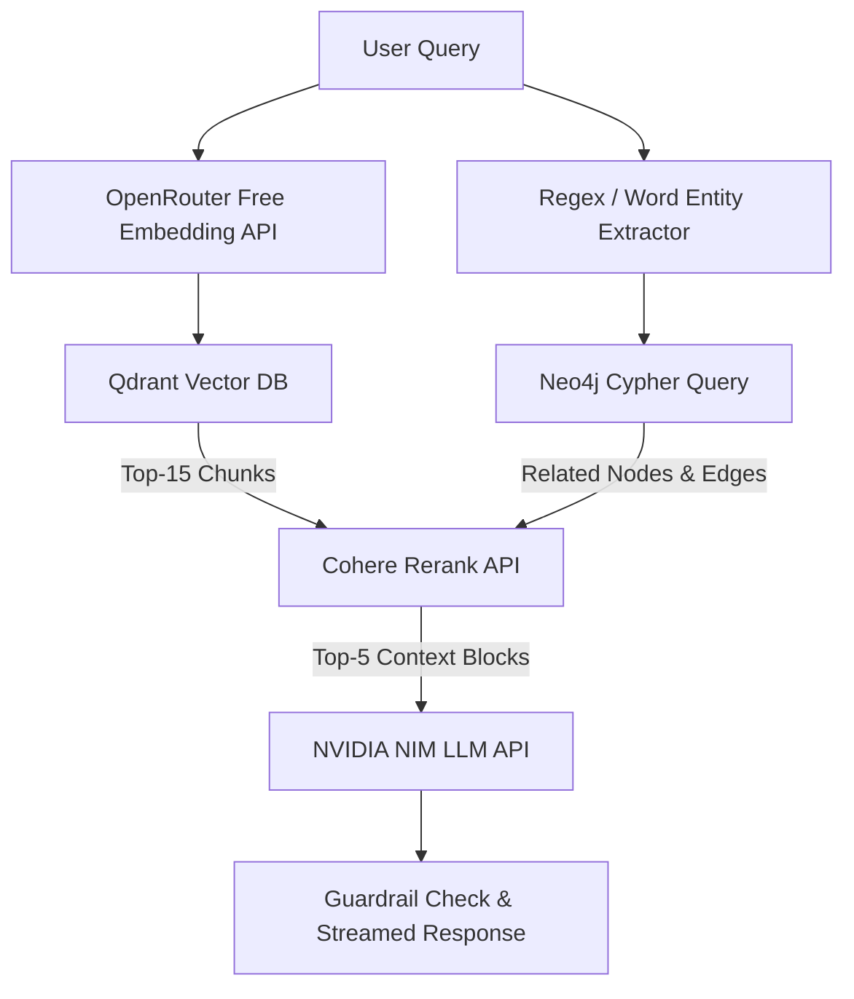

# Backend Service — Digital Twin Persona & Agentic Hybrid RAG

High-performance Node.js / Express backend powering Rohan Dhanraj Yadav's interactive Digital Twin AI assistant.

---

## 🏛 Architecture & Retrieval Pipeline

The backend supports two pluggable RAG strategies configured via `RAG_STRATEGY`:
1. **`facts` (Default)**: Fast, deterministic, zero-database facts retrieval via `factsRagAdapter.ts` grounded directly in structured JSON facts (`professionalFacts.json`).
2. **`hybrid`**: Enterprise agentic knowledge graph and vector retrieval pipeline using Qdrant, Neo4j, Cohere Rerank, and NVIDIA NIM LLM.

### Agentic Knowledge Graph & Hybrid RAG Retrieval Flow



### Retrieval & Pipeline Components

- **Vector Retrieval (`Qdrant`)**: Semantic search using vector embeddings generated via OpenRouter embeddings API, retrieving top-15 relevant text chunks from ingested career and project documents.
- **Knowledge Graph Traversal (`Neo4j`)**: Regex and token-based entity extraction drives Cypher queries matching relational graph nodes and multi-hop edges across skills, companies, projects, and domains.
- **Cross-Encoder Reranking (`Cohere Rerank`)**: Unifies vector candidate chunks and relational graph context blocks into a single prioritized list, surfacing the top-5 highest scoring context items.
- **LLM Generation (`NVIDIA NIM` / `OpenRouter`)**: Generates streaming responses with a first-person Digital Twin persona ("I am Rohan...") grounded strictly in retrieved context.
- **Safety & Guardrails (`guardrailService.ts`)**: Evaluates incoming queries for prompt injection and jailbreak attempts, while scanning output streams to mask sensitive credentials/phone numbers while strictly whitelisting Rohan's verified contact information (`rohan.dhanraj.y@gmail.com`, LinkedIn, and portfolio).

---

## 🔌 Pluggable RAG Dispatcher (`ragProvider.ts`)

The backend dynamically dispatches retrieval queries based on the `RAG_STRATEGY` environment variable:

```typescript
// backend/src/services/ragProvider.ts
export function getRagStrategy(): "facts" | "hybrid" {
  return process.env.RAG_STRATEGY?.toLowerCase() === "hybrid" ? "hybrid" : "facts";
}
```

| Strategy | Engine | Context Source | Latency | External DB Required |
| :--- | :--- | :--- | :--- | :--- |
| `facts` *(Default)* | `factsRagAdapter.ts` | `backend/src/data/professionalFacts.json` | < 5ms | None |
| `hybrid` | `ragService.ts` | Neo4j Graph + Qdrant Vector + Cohere | ~300-800ms | Neo4j + Qdrant Cloud |

---

## 📂 Directory Layout

```
backend/
├── src/
│   ├── config/
│   │   ├── db.ts               # Database connections (Neo4j, Qdrant, MongoDB)
│   │   └── env.ts              # Environment variable validation & defaults
│   ├── data/
│   │   ├── professionalFacts.json  # Ground-truth career facts (experience, skills, projects)
│   │   └── documentTree.json       # Structured hierarchy fallback for hybrid RAG
│   ├── legacy/
│   │   ├── ragEngine.ts        # Preserved legacy client-side engine (backend reference)
│   │   └── documentTree.ts     # Document tree definitions
│   ├── routes/
│   │   └── chat.ts             # Express routes for chat streaming (/api/chat)
│   ├── scripts/
│   │   └── ingest.ts           # Batch ingestion into Neo4j & Qdrant
│   ├── services/
│   │   ├── factsRagAdapter.ts  # Deterministic intent-aware facts retrieval
│   │   ├── guardrailService.ts # Injection defense & PII masking with contact whitelist
│   │   ├── llmService.ts       # Digital Twin persona prompt & SSE streaming
│   │   ├── ragProvider.ts      # Strategy dispatcher ('facts' vs 'hybrid')
│   │   └── ragService.ts       # Neo4j Cypher + Qdrant vector retrieval service
│   └── index.ts                # Server entry point
├── Dockerfile
├── package.json
└── tsconfig.json
```

---

## ⚙️ Environment Variables

Create a `.env` file in `backend/`:

```env
PORT=5000
NODE_ENV=development

# RAG Strategy Selection ('facts' or 'hybrid')
RAG_STRATEGY=facts

# LLM & Embedding Providers
NVIDIA_API_KEY=your_nvidia_nim_key
OPENROUTER_API_KEY=your_openrouter_key
COHERE_API_KEY=your_cohere_key

# Databases (Required only if RAG_STRATEGY=hybrid)
QDRANT_URL=https://your-qdrant-cluster.qdrant.tech
QDRANT_API_KEY=your_qdrant_api_key
NEO4J_URI=neo4j+s://your-neo4j-instance.databases.neo4j.io
NEO4J_USER=neo4j
NEO4J_PASSWORD=your_neo4j_password
```

---

## 🚀 Running & Testing

### Install Dependencies
```bash
npm install
```

### Run Unit Tests
```bash
# Run unit test suite (excluding remote database connectivity)
npx vitest run --exclude "**/prodDbConnectivity.test.ts"
```

### Build for Production
```bash
npm run build
```

### Start Server
```bash
npm start
```
